# PPSSPP verification

These captures were produced with PPSSPP v1.20.4 using the **software**
renderer on a headless Xvfb display. No PSP hardware was available, so this is
emulator verification only.

The EBOOT was built with `bash docker/build.sh` and the test script was copied
next to it as `script.lua` (with `assets/` alongside). Each image is downscaled
from the 960x544 PPSSPP window to the native 480x272 PSP resolution. Some
earlier captures include PPSSPP's `Log to file` banner; it is part of the
emulator OSD, not the game. The splash runs were taken with logging disabled.

| Capture | What it shows | Source |
|---|---|---|
| 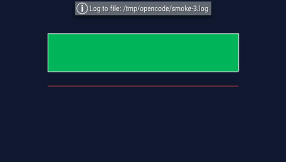 | Dark background, green fill, white outline and red line | `demos/smoke.lua` |
| 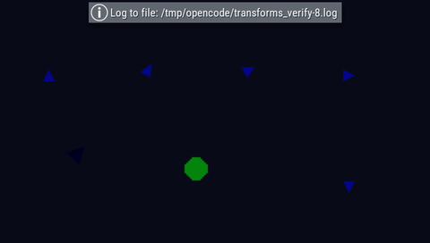 | Triangle at 0/30/60/90 degrees, 45-degree scaled + tinted triangle, 2x circle, vertically flipped triangle | `transform_check.lua` |
| 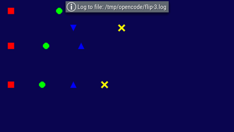 | Normal, horizontal, vertical and combined flips; explicit source rects and whole-sheet blit | `demos/flip.lua` |
| 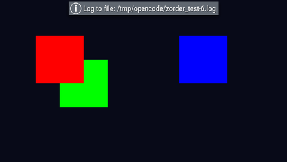 | Red (z=10) drawn before green (z=5); red remains on top in the overlap. Blue (z=20) is separate | `depth_check.lua` |
| 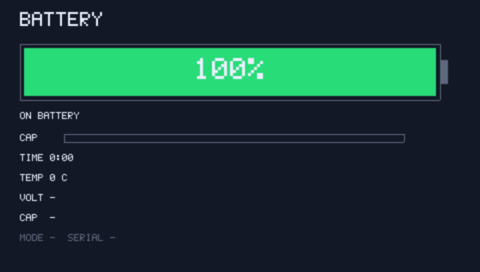 | `batt` telemetry: 100%, ON BATTERY, 0:00 remaining, 0 C; PPSSPP reports no voltage/capacity, so those fields show `-` | `demos/battery.lua` |
| 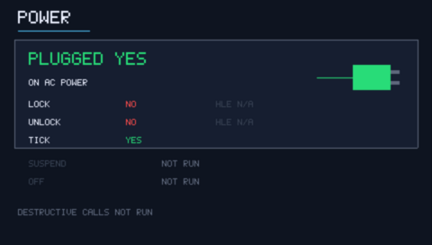 | `power` demo: PLUGGED YES, TICK YES; PPSSPP 1.20.4 does not implement lock/unlock, so those show NO with HLE N/A; suspend/off are marked NOT RUN | `demos/power.lua` |
| 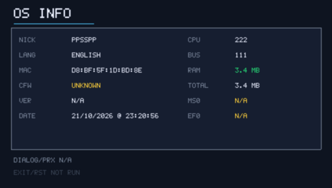 | `os` demo: PPSSPP nickname/language/MAC, RTC date, 222/111 MHz clocks and free/total memory; PPSSPP reports no flash0 version or MS/ef0 capacity, so those show N/A; CFW is UNKNOWN | `demos/os.lua` |
| 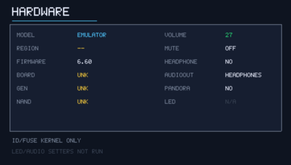 | `hw` demo: EMULATOR, firmware 6.60, region `--`, session volume 27/mute OFF, no headphone; board/gen/NAND and LED show documented kernel-only fallbacks; audio route reports mode 0 because of PPSSPP's `GetMode` HLE | `demos/hardware.lua` |
| 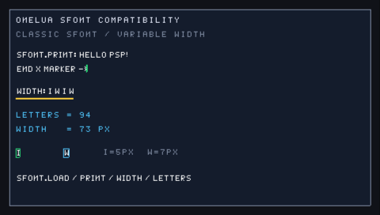 | `sfont` demo: fixed-font header, classic SFont print with final X marker, variable-width measurement, 94-letter count and `sfont.load` summary | `demos/sfont.lua` |
| 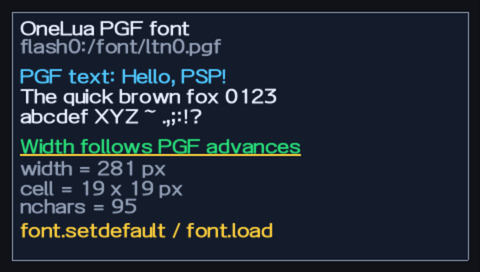 | PGF demo: `flash0:/font/ltn0.pgf` loaded through `font.load`, selected with `font.setdefault`, proportional text and measured width/line-height | `demos/pgf.lua` |
| 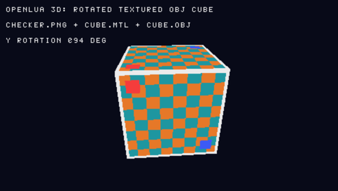 | Textured rotating OBJ cube through `amg`/`cam3d`/`model3d`/`texture3d`, with the 2D HUD drawn after `amg.mode2d(1)` | `demos/3d.lua` |
| 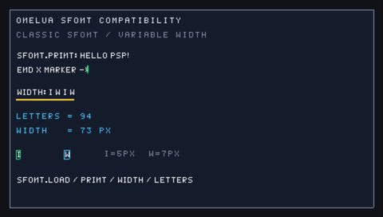 | 2D regression after the 3D work: classic SFont text, variable widths, markers and lines still render normally | `demos/sfont.lua` |
| 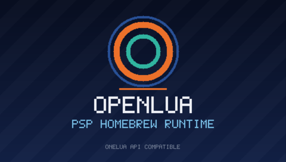 | Current splash: generated `assets/splash.png`, centred and scaled to the screen with a fade | `demos/splash.lua` |
| 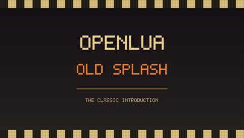 | `splash.old()` showing the generated retro `assets/splash_old.png` | `demos/splash.lua` |
| 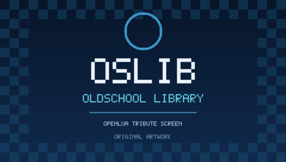 | `splash.oldschool()` showing the original OSLib-style tribute (not historical OSLib artwork) | `demos/splash.lua` |
| 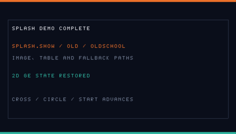 | Normal 2D frame loop after four splash slideshows, proving the GE state and clear colour were restored | `demos/splash.lua` |
| 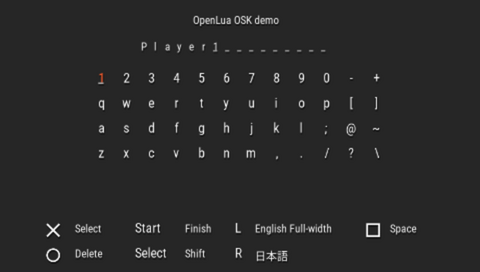 | System OSK open: description, initial `Player` text, 20-character limit, normal English keyboard | `demos/osk.lua` |
| 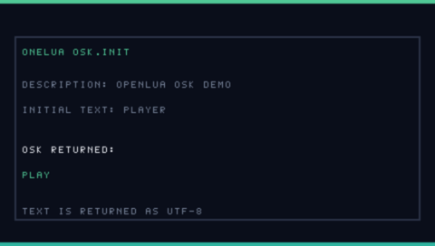 | After deleting two characters and finishing: `osk.init` returned `Play`, and the normal 2D loop resumed | `demos/osk.lua` |
| 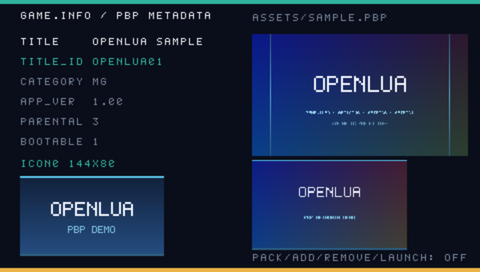 | `game` demo: PARAM.SFO TITLE/TITLE_ID/CATEGORY/APP_VER/PARENTAL_LEVEL/BOOTABLE, ICON0 `144x80`, and the extracted PIC1/PIC0 artwork | `demos/game.lua` |
| 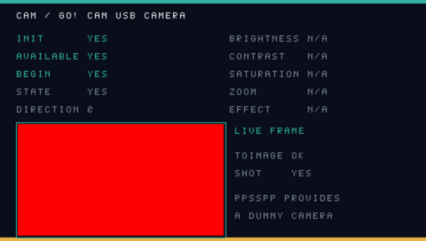 | `cam` demo: init/available/begin/state YES, 480x272 dummy camera frame, `toimage` OK and `shot` YES; control getters show `n/a` because PPSSPP lacks that HLE | `demos/cam.lua` |
| 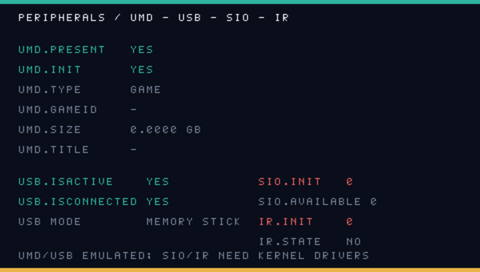 | `umd`/`usb`/`sio`/`ir` demo: UMD present/init/type GAME, empty gameid/title and `0.0000` size for a homebrew EBOOT, USB active/connected YES, SIO/IR unavailable | `demos/peripherals.lua` |

Before these fixes the smoke test showed only the clear colour, sprites sampled
the transparent corner of the sheet, and window capture of the engine's GUI was
garbage. See the issue comments for [#19] and [#20].

The 3D capture was taken with `demos/3d.lua` and the original generated
`assets/3d/` cube, MTL and checker texture. PPSSPP's OSD messages were disabled
in the emulator config for this capture. The rotating cube is textured and
depth-tested; the 3D→2D switch is explicit (`amg.mode2d(1)`), and the HUD uses
the normal 2D blitter. `demos/sfont.lua` was rerun afterwards as a 2D
regression check. No PSP hardware was available, so 3D remains
PPSSPP-verified only.

The four splash captures come from `demos/splash.lua` and the generated
`assets/splash*.png` images. The first three were taken at roughly 1 s, 3 s and
5 s into the demo's slideshows; the last one was taken after the 10 s sequence,
where the script continues with a normal `screen.clear`/`screen.print`/
`screen.flip` loop. Logging was disabled for these runs, so the earlier
`Log to file` banner does not appear. The timed/skip loop and input edge
detection are PSP-only; the host test covers argument handling, image loading,
slide skipping and the no-asset fallback. No PSP hardware was available, so
splash is also PPSSPP-verified only.

The OSK captures come from `demos/osk.lua` at a 960x544 PPSSPP window
(downscaled to 480x272). The first shows the system keyboard after
`osk.init("OpenLua OSK demo", "Player", 1, 20, 1, 1)` opened; the second was
taken after pressing Circle twice (deleting `er`) and Start, where the demo
draws `osk.init`'s return value `Play`. This confirms the dialog opens, edits
and returns UTF-8 text without leaking GE/display state into the following 2D
frames. PPSSPP 1.20.4 provides no OSK cancel control (Circle deletes
characters) and its OSK HLE always reports `PSP_UTILITY_OSK_RESULT_CHANGED`,
so the `nil` cancel branch cannot be exercised in the emulator; it is covered
by `test/host/test_osk.lua` and the PSP-only result handling. No PSP hardware
was available.

The `game` capture comes from `demos/game.lua` at a 960x544 PPSSPP window
(downscaled to 480x272). The demo reads the generated `assets/sample.pbp`,
prints the PARAM.SFO fields returned by `game.info`, and blits ICON0, PIC0 and
PIC1 as ordinary image handles returned by `game.geticon0`/`getpic0`/`getpic1`.
This confirms the bounds-checked PBP/SFO parser, in-memory image decode and the
read-only Lua surface. The parser and malformed-input paths are covered by
`test/host/test_pbp.c` and `test/host/test_game.lua`; no PSP hardware was
available.

The `cam` capture comes from `demos/cam.lua`. PPSSPP's `sceUsbCam` HLE supplies
a dummy 480x272 JPEG frame, so the demo confirms `cam.init`/`cam.begin`, live
`cam.render` scaling, `cam.toimage` returning a normal image handle, and
`cam.shot` writing a 480x272 PNG snapshot. The image is the emulator's red
dummy frame, not a real camera picture. PPSSPP 1.20.4 does not implement the
`sceUsbCam` control get/set HLE, so brightness/contrast/saturation/zoom/effect
show `n/a`; those setters and the absent-hardware contract are covered by
`test/host/test_cam.c` and `test/host/test_cam.lua`. No GO! CAM accessory or
PSP hardware was available.

The `peripherals` capture comes from `demos/peripherals.lua`. PPSSPP's
`sceUmd` HLE reports the homebrew EBOOT as an inserted `GAME` disc, so the demo
confirms `umd.init`, `umd.present` and `umd.type`. There is no
`disc0:/PSP_GAME/PARAM.SFO` on that volume, so `umd.gameid` stays empty,
`umd.info` is `nil` and `umd.size` is `0.0000`; those fields need a real game
disc. PPSSPP implements the `sceUsb` state flags, so `usb.mstick` reports
active/connected `YES`; it does not implement `_usbdevice`, UART or IR, so the
UMD/flash USB modes and the `sio`/`ir` modules remain documented only. The demo
never dumps a disc or exposes flash, and `umd.dumpiso`/`umd.launch` are not
registered. The UMD helpers and the absent-hardware contract are covered by
`test/host/test_umd.c` and `test/host/test_peripherals.lua`. No PSP hardware,
game UMD, USB host or SIO/IR hardware was available.

[#19]: https://github.com/epr-ds/openlua/issues/19
[#20]: https://github.com/epr-ds/openlua/issues/20
[#36]: https://github.com/epr-ds/openlua/issues/36
[#37]: https://github.com/epr-ds/openlua/issues/37
[#38]: https://github.com/epr-ds/openlua/issues/38
[#39]: https://github.com/epr-ds/openlua/issues/39
[#40]: https://github.com/epr-ds/openlua/issues/40
[#41]: https://github.com/epr-ds/openlua/issues/41
[#42]: https://github.com/epr-ds/openlua/issues/42
[#43]: https://github.com/epr-ds/openlua/issues/43
[#44]: https://github.com/epr-ds/openlua/issues/44
