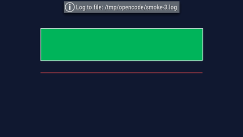
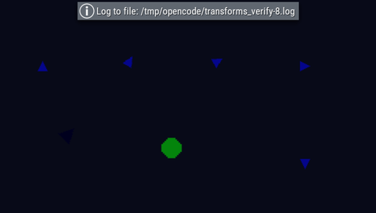
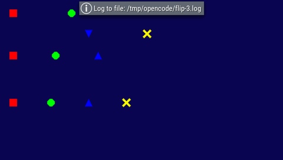
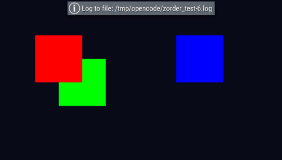

# Renderer verification (PPSSPP)

These captures were produced with PPSSPP v1.20.4 using the **software**
renderer on a headless Xvfb display. No PSP hardware was available, so this is
emulator verification only.

The EBOOT was built with `bash docker/build.sh` and the test script was copied
next to it as `script.lua` (with `assets/` alongside). Each image is downscaled
from the 960x544 PPSSPP window to the native 480x272 PSP resolution. The
`Log to file` banner is PPSSPP's own OSD; it is not part of the game.

| Capture | What it shows | Source |
|---|---|---|
|  | Dark background, green fill, white outline and red line | `demos/smoke.lua` |
|  | Triangle at 0/30/60/90 degrees, 45-degree scaled + tinted triangle, 2x circle, vertically flipped triangle | `transform_check.lua` |
|  | Normal, horizontal, vertical and combined flips; explicit source rects and whole-sheet blit | `demos/flip.lua` |
|  | Red (z=10) drawn before green (z=5); red remains on top in the overlap. Blue (z=20) is separate | `depth_check.lua` |

Before these fixes the smoke test showed only the clear colour, sprites sampled
the transparent corner of the sheet, and window capture of the engine's GUI was
garbage. See the issue comments for [#19] and [#20].

[#19]: https://github.com/epr-ds/openlua/issues/19
[#20]: https://github.com/epr-ds/openlua/issues/20
